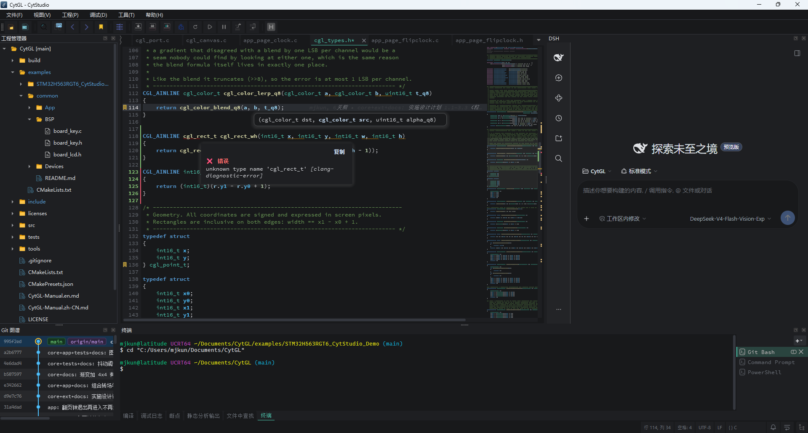

  <b>English</b> · <a href="README_zh-CN.md">简体中文</a>

  

<h1 align="center">CytStudio</h1>

  <strong>An Embedded Development IDE</strong> 
  AI Agent · Debugger · Code Analysis · Built for MCU/Embedded Engineers

  <a href="#-key-features">Features</a> •
  <a href="#-quick-start">Quick Start</a> •
  <a href="#-build-from-source">Build</a> •
  <a href="#-license">License</a>

---

## 📖 Introduction

**CytStudio** is an embedded development IDE built by a solo developer, exploring what an alternative tool outside the mainstream could look like. It tries to bring together an AI coding agent, a hardware-aware debugger, static code analysis, and everyday project tooling in one place — not to replace the tools you already trust, but to offer another option worth trying.

If you work with ARM Cortex-M, FreeRTOS, or bare-metal projects, CytStudio supports importing from CubeMX, IAR, and Keil, CMSIS-Pack component management, J-Link / DAPLink debugging with FreeRTOS awareness, FLM-based on-chip flash programming, and an AI agent that can read, write, build, and debug code alongside you. It's a personal project, a constant work in progress, and always open to feedback.

---

## ✨ Key Features

### 🤖 AI Agent
- **DeepSeek Harness (dsh)**: A built-in AI coding agent that can read, write, build, and debug code alongside you. It ships with the installer — works offline, no setup required. It replaces the previous CytMind chat panel.
- **Multi-Provider LLM**: DeepSeek, Pi, and more via the dsh LLM layer, with retry support
- **Rich Tool System**: File operations, bash/PowerShell, web search, terminals, and goal/todo tracking — all directly from the chat
- **Subagents & Workflows**: Split tasks across nested sub-agents (Claude Code and Codex included) and orchestrate multi-step workflows
- **Plugin Marketplace (dshmarket)**: Browse, install, and manage agent plugins from inside the IDE
- **MCP Client**: Full Model Context Protocol client support
- **Skill System**: User-defined and project-level skills with hot reload
- **Sessions**: Persistent, searchable sessions with auto titles, checkpoints, and log export
- **Permissions & Sandboxing**: Trust-gradient permission presets with user-approval dialogs; sandboxed bash / PowerShell / filesystem execution
- **IDE Tool Bridge**: The agent drives 28+ IDE features directly from the chat — build, J-Link / DAPLink / simulator debugging, Excel, project config, editor, and project management
- **Project Management Tools**: Switch, open, or create projects directly from the agent
- **Workspace & Theme Sync**: The agent panel follows your current workspace and matches the IDE theme instantly; plugins sync at the content level to avoid overwrites
- **IDE Event Injection**: Build failures and breakpoints wake the agent with relevant context

### 🔍 Code Analysis (In Refinement)
- **Static Analysis (clang-tidy)**: Run a project-level scan from the Project menu — pick the files and check categories, then watch results stream in live. Double-click any diagnostic to jump to the source line, and export a self-contained HTML report with a summary, category bar chart, and code context.
- **Call Graph**: Interactive call graph with expand/collapse
- **Control Flow Graph**: Per-function CFG extraction and visualization
- **Code Metrics**: Cyclomatic complexity, Halstead metrics, nesting depth, LOC
- **Duplicate Detection**: Cross-file duplicate code detection
- **Inheritance / Include Analysis**: Class hierarchy and include graph visualization
- **Export**: Image (PNG/SVG), HTML report, CSV data export

### 🐛 Hardware Debugger
- **J-Link Interface**: Full J-Link integration
- **CMSIS-DAP / DAPLink Probes**: Native CMSIS-DAP v1 (HID) / v2 transport via hidapi/libusb — DAPLink probes work out of the box
- **FreeRTOS Dashboard**: Task list, stack usage, runtime stats
- **Breakpoints & Watchpoints**: Conditional breakpoints, data watchpoints
- **Variable Inspection**: Tree-structured live variable view
- **Hover Evaluation Card**: While paused, hover a variable or expression to get a card evaluating through the same path as Live Watch, with struct expansion, add-to-watch and copy-value actions
- **Disassembly**: Mixed source/assembly view
- **Memory View**: Hex dump with configurable columns
- **Register View**: CPU and peripheral register inspection
- **Call Stack**: Precise, frame-accurate stack traces while debugging
- **High-Speed Sampling**: Microsecond-level data sampling & waveform
- **Probe-Agnostic Design**: Flash download, erase, and launch work consistently across debug probes, with room to grow support for more debuggers over time

### 🧪 Simulation Debugger (Virt-Simulator)
- **No Board Required**: QEMU-backed instruction-level Cortex-M simulation through the same debug panels — flash, reset, breakpoints, stepping, variables, and waveforms without hardware
- **Automatic Target Selection**: Machine profiles match on core type + firmware link address — generic Cortex-M0 / M0+ / M3 / M4 / M7 / M33 / M23 machines plus STM32F1 / F2 / F4 and TI LM3S6965 compatible machines, or pick one manually
- **Target printf in the Debug Log**: The guest's serial output streams live into the debug log panel, prefixed `[目标串口]`

### 💾 CMSIS-Pack & Flash Programming
- **CMSIS-Pack Manager**: Browse, install, and remove packs — device support wires into your build automatically
- **Component Selection**: Pick components from a tree (e.g. CMSIS-DSP) in a dedicated property page — sources, macros, and include paths merge straight into the build
- **Path Macros**: CMSIS component source/header paths merge into the project's "Source & Paths" config, with `$(TOOLKIT_DIR)` / `$(USER_PACKS_DIR)` path macros for flexible path management
- **Read-Only Component Tree**: Checked components appear in the project tree Keil-style (`CMSIS Components` → component → source files), each folder and file marked with a gray lock badge and a read-only tooltip. Double-click opens the pack source file read-only; virtual nodes only offer read-only context menus (no new/rename/delete). Nodes auto-sync after opening a project or changing the configuration.
- **RTE Build Integration**: Checked components compile directly into your project; stale RTE sources are reset on every build
- **Editor Parity**: CMSIS-NN / CMSIS-DSP headers no longer trigger false red squiggles — the editor understands packs the same way the build does
- **Fast Project Load**: Installed packs are re-scanned only when they change — opening a workspace or building no longer re-scans everything from scratch
- **Import Progress**: Pack installs show a cancelable progress dialog — the IDE stays responsive and you stay in control
- **FLM Algorithm Parsing**: Load Keil-style `.flm` flash algorithms with their device layout (base address, size, page/sector geometry)
- **FLM RAM Execution Engine**: On-chip flash programming in RAM — sector erase + page programming, per-device address allocation
- **Auto Algorithm Selection**: Automatically picks the best flash algorithm for your chip — J-Link built-in first, then installed pack FLM — including chips J-Link doesn't recognize, and stays reliable even when none is found
- **Force Built-in FLM**: A debug-config toggle to force the built-in flash algorithm; auto-locked for DAPLink (which has no built-in algorithm)
- **Flash Progress UI**: Visual download/erase progress with algorithm details
- **Simulation Flashing**: Firmware is written straight through the debug channel (GDB `M` packets) — no flash controller model needed, and Download / Erase behave as on hardware

### 📝 Code Editor
- **Clang-Based Completion**: Context-aware, semantic code completion
- **Syntax Highlighting**: Large files open instantly, and colors stay stable while you type; syntax coloring for Markdown (`.md`), Shell (`.sh`), PowerShell (`.ps1`), and Python (`.py`) files
- **Jump to Definition**: Fast, accurate cross-file navigation (headers, `extern "C"`, C++ overloads)
- **Signature Help Cards**: Overload signatures and parameters in a floating card, with the current parameter in accent bold; it flips above the caret when space runs out
- **Change Status Gutter**: A strip beside the line numbers marks each line Unsaved / Saved / Added in Git, with a tick and triangle where code was deleted. Click a mark to inspect the diff and revert that hunk in place — a single Ctrl+Z undoes it
- **Git Blame Ghost Text**: Faded italic author and time at the end of the line — painted only, never inserted, so the caret, copied text and undo stack stay untouched
- **Code Bookmarks**: `Ctrl+M` to toggle, `F2` / `Shift+F2` to cycle within a file, `Ctrl+F2` to jump across files, with per-bookmark notes persisted along with the project
- **Whole-File Overview Marks**: Git changes, search hits and diagnostics drawn directly on the scrollbar — no extra column; click a mark to jump
- **Minimap**: Code overview minimap with scroll synchronization
- **Symbol Outline**: File structure outline for quick navigation
- **Multi-File Search**: Project-wide regex search with result panel
- **Markdown, PDF, Images & Excel**: Open Markdown, PDF, images, and Excel (`.xls` / `.xlsx` / `.xlsm`) tables in a fast built-in viewer tab — export Markdown previews to PDF, or browse them in browser-style mode
- **Empty-State Shortcuts**: With no document open, the editor shows a themed watermark and quick actions (New File / Open Folder / Open Recent)

### 🔧 Build System
- **Build Diagnostics**: Parsed compiler errors/warnings with source navigation
- **Async Build**: Non-blocking build execution with streaming output
- **Project Config**: Toolchain and build configuration management
- **Configurable Output**: Output file name (default `Project`) and per-file / per-folder compile optimization overrides, with `.bin` generation via `objcopy`
- **CMSIS-Pack RTE Integration**: Selected pack components contribute sources, macros, and header paths to every build
- **Robust Command Lines**: Large projects link reliably, bypassing the Windows 32 KB command-line limit

### 📦 Project Management
- **Project Migration**: Import from **STM32CubeMX**, **IAR EWARM**, **Keil MDK**
- **Git Integration**: Built-in git operations, diff viewer, log graph; refreshes automatically after commit, staging, or AI writes
- **Project Tree Copy/Paste**: Right-click copy/paste in the project tree, interoperating with the system clipboard
- **Multi-Tab Terminal**: VSCode-style interactive terminal (PowerShell / Git Bash / CMD) — right-aligned tab bar, scrollback, Tab completion, theme adaptation, monospace fonts
- **Recent Projects**: Quick-access recent project list
- **Theme System**: Light/dark theme with accent color customization; checkboxes and radio buttons stay clearly visible across themes

### 🌐 Internationalization
- **Global Language Switch**: Full Chinese / English switching from the settings dialog
- **Dual Translation Pipeline**: Full Chinese and English translations, kept fresh with a one-command refresh toolchain
- **Bilingual Installer**: The setup wizard is available in both Chinese and English, including task descriptions and prompts
- **Restart Confirmation**: Language changes apply after a friendly confirm-and-restart flow

### 📊 Data Visualization
- **Real-Time Waveform**: Oscilloscope-style data plotting with measurement tools
- **Legend & Cursor**: Highlightable legend, multi-cursor measurement
- **Data Export**: CSV export for captured waveform data

### 🔐 License & Activation
- **Online Activation**: Secure hardware-bound license activation

### 🔄 Update & Maintenance
- **In-App Update Checker**: Manual (`Help → Check for Updates`) and automatic on startup
- **Smart Update Dialog**: Release notes with **Force Update** / **Skip This Version** options
- **Dual-Channel Updates**: Adaptive semver prerelease parsing with **stable** / **beta** channels
- **Single Version Source**: One version number keeps the About dialog, installer, and update checks in sync

---

## 🚀 Quick Start

### Download

Get the latest installer from [GitHub Releases](https://github.com/cytstudiooo/cytstudio/releases).

- **CytStudio_Setup_Vx.x.x.exe** — Windows installer with modern wizard UI

### System Requirements

| Requirement | Minimum |
|-------------|---------|
| OS | Windows 10 / 11 (x64) |
| RAM | 4 GB |
| Disk | 4 GB free |

### Installation

1. Download `CytStudio_Setup_V2.4.6-rc.1.exe`
2. Run the installer and follow the wizard
3. Launch from desktop shortcut or Start Menu

---

## 🔨 Build from Source

### Prerequisites

- **Qt 6.10+** (MSVC 64-bit on Windows)
- **LLVM/Clang 18+** (for code completion and analysis)
- **J-Link** (for debugger features)
- **QEMU** (optional — only for the Virt-Simulator; the installer bundles a trimmed `qemu-system-arm` under `config/virt-sim`)

---

## 🔌 Supported File Associations

| Extension | Description |
|-----------|-------------|
| `.rproj` | CytStudio Run Configuration File |
| `.cproj` | CytStudio Project File |

---

## 📄 License

© 2024–2026 CytStudio. All rights reserved.

This project is proprietary software. See the license terms provided with your installation.

---

## 📧 Contact

- **Email**: [cyte_studio@foxmail.com](mailto:cyte_studio@foxmail.com)
- **Author**: [mjkun](https://github.com/mjkun)

---

  Built with Qt 6 · C++17 · QML · LLVM/Clang · J-Link · QEMU · miniz · DeepSeek Harness

